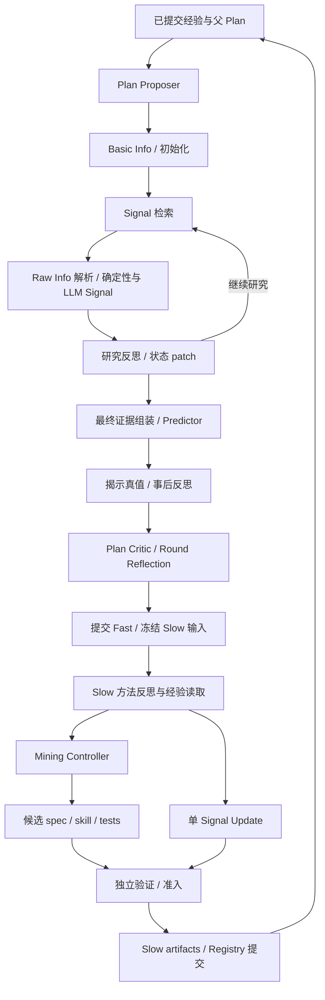

# Fast → Slow 各环节 Context 审计

2026-10-01。审计基线：`42daede2a00c26f3963ff02854ef1fcfea698b88`。本文梳理必要输入、实际输入、重复与缺失，供下一步统一运行检测和修复契约使用；不修改运行逻辑，也不把建议视为已生效设计。

结论：**已有局部 context、分层读取、增量更新和纠错机制；缺口是各阶段没有按同一组输入依赖和证据闭包标准落实。** Fast 主要需要检查入口证据质量、反思的目录负担和修复权限一致性。Slow Mining 同时存在重复输入和工具结果丢失；不能仅靠缩短 prompt 解决。当前候选物化已拆分生成，不应再按历史实现归因。

## 审计范围与证据口径

- 当前代码、架构和模块 spec 用于判断“应当怎样”和“当前怎样组装”。
- v154 的 328 条 journal 记录覆盖实际发生的初始化、检索、Signal 执行、反思、预测、事后反思、Mining。它没有完整走完 Fast/Slow：`last_completed_round=0`、`last_completed_cycle=0`，活动 cycle 在 `slow_loop`。不能给未到达阶段编造 v154 的输入。
- v143 的 1,366 个已保存请求用于补充 Plan Proposer、Critic、Slow Reflection、source selector、Materialization、Update；v142 的请求补充 Round Reflection。这些是历史样本，不代表当前代码逐字相同。
- 统计单位为 **payload 的规范化紧凑 JSON UTF-8 字节**，KB 按 1,000 字节。不包含 system prompt，不等于 token 数；机器表另列 system prompt 大小。字段中位数按字段实际出现的样本计算，不能相加推算阶段中位数。
- 请求数是不同保存请求数，不是逻辑步骤数、候选数或 HTTP 调用数。v143/v142 另与 `attempts.json` 按 request hash 对账；其中存在预存而未发送的请求，以及已尝试但未成功的请求。例如 v143 Critic 首答 2 个请求均有 attempt、均没有 completed；v142 Round 首答 1 个未 completed，2 个 correction 请求 completed。
- 输入清单、SHA-256、各阶段分位大小、代表样本路径和字段结构见 [机器审计表](</Users/l/Project/Recommandation/reports/fast-slow-context-audit-20261001.json>)。清单按各 run 根目录解析，不复制证据正文或 provider 凭据。

“必要 context”必须满足四个条件：能完成当前职责；能看到支持和反证及不足；能满足输出 validator 的真实约束；能解析引用并合法更新状态。字数少不是充分条件。本文将**实测/代码确认的缺陷**与**可能干扰、尚未验证因果的候选问题**分别标记。

## 完整链路

这是职责与数据依赖图，不表示所有分支每次都执行。v154 从 harness 的 Fast 结果进入 `slow_only`；不能把它当作完整 Plan 演化周期。当前生产 Mining 在冻结 sampling manifest 且模型具备 JSON caller 时走 `LabelAwareMiningController`；H1/H2/H3、E1/E2 是保留的协议/历史路径，不能直接拿来描述 v154 的生产链。

## 各环节逐项对照

| 环节与职责 | 完成职责所需 context | 当前实际输入 / 证据 | 审计判断 |
| --- | --- | --- | --- |
| 1. Plan Proposer：提出下一份研究流程 | 固定 prior、合法操作菜单、父 Plan 可继承字段、相关经验 brief、原文可读引用、预算与变更约束；不需要逐 case 的全量原始文件 | v143：5 请求，55.7 KB 中位数；代表请求中 `meta_info` 47.8 KB，父 Plans 6.7 KB；current code 增经验 snapshot hash、分页读取通道 | 有 brief/fetch 分层，但反馈占主导。相关性选择优先于按数量裁剪；不能删掉用于继承完整 Plan 的父字段 |
| 2. Basic Info / 初始化：形成初始假设和信息需求 | 闭合菜单取得的公司定位事实、PIT 截止时间、评价期限、运行时计算的价格锚点、必要原文依据、明确缺口；不需整个 oracle | v154：10 请求，41.0 KB；`basic_info` 字段中位数 39.7 KB，包含各请求 projections；锚点和 computed metrics 单独注入 | 全库没有直接进入模型。入口投影仍是主要负担，应检查每张卡是否回答菜单问题、是否保留段落语境。长原文不是自动判定为冗余 |
| 3. Signal 检索：选择能回答当前需求的能力 | 未执行候选卡、待解决 needs、适用性相关假设/反证、此前简短结果、选择上限、PIT；不需证据全文、实际执行 skill、结果标签 | v154：27 请求，21.7 KB；候选卡字段中位数 16.3 KB。代码把 ResearchState 投影成 applicability view，把已有结果压成 state/interpretation/status | 这是已经实施局部 context 的环节。卡含 learned_profile 与 routing answer phrases；可检查重叠，但不能为了短而删适用范围/不足/历史路由信息 |
| 4. Raw Info 解析 / 确定性 Signal：取数和计算 | 对应 Signal 的来源、窗口、单位、口径、可比较记录、时间约束和 lineage | 本地 resolver 与确定性函数完成；不必新增 LLM context | 可靠性来自程序 contract。取错口径、缺历史行情、数据不足不能通过 LLM 改写补成有效数据 |
| 5. LLM Signal 执行：从选定证据判断一个或小批 Signal | 该 Signal 的 spec/skill、合格投影 ID、必要支持和反证、as_of、缺省/不足规则、可精确引用原文 | v154：26 请求，56.9 KB，最大 131.6 KB；source projection 中位数 49.2 KB。小批 Signal 共享投影，并限制各 Signal 的 eligible IDs | 已有去重共享和失败 Signal 单独重试。大输入主要是真实证据，不是全量系统状态；要检查窗口选择和证据覆盖，不能仅靠从头截断或只保留正证 |
| 6. 研究反思：将本轮发现增量合并入状态 | 上一有效状态、本轮结果、可引用证据、执行意图、need transition 与容量约束、评价锚点、相关可读目录 | v154：27 请求，35.5 KB；每个非 correction 请求都有 `document_catalog`，字段中位数 17.8 KB；其余包括 prior state、batch、patch contract 和 need contract | 已是 patch，不是每轮从零生成。目录占明显份额，可分组/按需读取；更关键的是 needs 与 resolved questions 等联动约束必须同时可见并可合法修复 |
| 7. 最终组装 / Predictor：盲判断未来走势和幅度 | 截止时点可见证据、当前有效研究结论、反证与未知、运行时 baseline、预测目标/期限；不能看到真值或事后反馈 | v154：6 请求，31.7 KB；代表 final context：Basic 10.2、Signal rounds 5.7、引用证据 5.3、state evolution 3.3、最终 state 6.8 KB | 架构明确要求最终输入承接之前可见信息。重复语义和旧假设是潜在干扰；先做显式撤销/替代和结构去重，直接删历史需上层设计决策 |
| 8. 真值揭示 / 事后反思：解释此次对错 | 不可变原预测、最终研究状态、Signal 结果与所引证据、运行时判定的真值/幅度反馈、来源目录 | v154：6 请求，21.4 KB；compact context 中位数 18.8 KB；代码不再携带全部 Basic 原文与 state evolution。v143 Jev 解释分支先有固定决策再解释 | 已有职责投影。研究不足和执行失败需要不同归因；不能把技术排除、缺数据解释成研究因子失效 |
| 9. Plan Critic：归纳一份 Plan 的表现 | Plan、runtime 指标、同条件父对照、简化 case 轨迹、技术完成情况、可选择的 case reflection briefs 与来源 | v143：2 首答请求，109.8 KB；briefs 47.5、parent comparisons 21.0、catalog 15.8、trajectories 14.8 KB；当前 helper 已移除完整 source context | 有压缩但多套表达可重叠：轨迹、对照、case brief、目录。应按 claim/ref 共享数据，并保留研究与技术失败的区别；历史失败不能单独归因于 context 大 |
| 10. Round Reflection：横向比较新 Plans | 当前轮完成记录、runtime 跨 Plan 比较、Plan reflection briefs、必要指标与来源；不需再生成每个 case/Plan 反思 | v142 首答 134.6 KB，correction 中位数 141.3 KB；当前代码移除 record 内重复 reflection；少于两个完整 Plans 显式 skip | 已经有部分去重。对照块、records 和 briefs 仍应检查共享事实；v143 没有该 LLM 阶段不能算缺日志 |
| 11. Fast 提交 / Slow 冻结：建立可信入口 | 已提交指针、冻结 feedback、Registry 版本/hash、sampling manifest、research targets、来源截止线 | 程序处理；v154 Fast 用累计 Registry v6，Slow workspace 则初始化为 seed v1 | **版本衔接缺口已确认**：反馈与待改能力的目录基线不同。模型上下文再短也不能消除这种来源不一致；应显式映射/拒绝不兼容输入 |
| 12. Slow 方法反思：从执行和实验反馈学方法 | 尚未消费的 required feedback、新旧方法 brief、测量契约、经验来源引用、槽位；不需重复全部 Fast Raw Info | v143：1 请求，63.0 KB，feedback units 59.6 KB；当前代码有 prior brief、required source 覆盖、已处理/pending refs | 反馈 artifact 可能包含大量可审计字段。应把“必须覆盖一条反馈”与“必须内联整个 artifact”区分，保留原件和 resolver |
| 13. Slow source selector：选需要深入阅读的来源 | 本角色任务、当前已选视图、来源卡、待补引用、预算/required refs | v143：6 请求，16.6 KB；代码限制一次 typed source selection、按整个 source entry 读取、维护 manifest | 方向正确。32 KB 读取预算是局部来源块约束，不是整个 Update payload 上限；目录卡要足够支持选择，不能只给不透明 refs |
| 14. Mining Controller：逐步发现可执行研究能力 | 当前 axis 的开发样本与允许标签、来源/属性能力目录、相关反馈 brief、当前假设和证据、**上次工具实际结果**、动作与剩余预算 | v154：187 请求，49.5 KB；`meta_info` 每次相同且 27.7 KB，meta disclosures/backlog needs 为空；fact/event/relation ID 清单持续内联。历史 v143 中位数 112.5 KB | **重复与缺失并存**：批反馈反复占大头；目录结果仅留下 inspected keys；light 预算为负后仍继续；仅收到 surge axis。详见下节 |
| 15. Mining 候选物化：变成 spec/skill/tests | 单候选、其引用证据、匹配的实现 contract；skill/tests 再拿已接受 spec/skill 与对应错误 | 历史 v143 为合体调用，12 请求，21.8 KB。**当前代码已拆成 spec → skill → tests，accepted 缓存有效模块** | 这已符合增量原则。spec 仍带完整 candidate contract，可考察按 modality 提供所需契约。缓存只证明同一次函数重试保留，不能直接宣称 crash 后模块级恢复 |
| 16. Signal Update：修改一个明确目标 | target spec/skill/profile、目标相关 induction 证据与观察、运行时 outcome relation、可修改字段、固定 tests、相关方法经验；holdout 隐藏 | v143：3 请求，120.1 KB；method memory 78.6、induction 23.5、candidate contract 13.8 KB。代表 memory 内 source entries 60.7 KB | 单目标边界已有，经验来源仍可能主导 context。需按目标关联筛选；target 中 spec/skill 与 vNext template 重复是可检验的去重候选，不能删固定 tests 约束 |
| 17. 验证 / 准入 / 跨周期提交 | 完整合并后输出、PIT、fixture 与独立 case、比较指标、版本/hash、提交指针 | 程序验证、独立执行与盲预测；按具体配置区分 provisional、validated、promoted 和 committed | 不能把 Mining/Update 使用的标签或回顾经验塞进盲预测。通过 parser、fixture 或本地 replay 都不等于 live gain 或周期完成 |

主要代码依据：[Plan roles](/Users/l/Project/Recommandation/src/stock_opportunity_agent/research/evolution_plan_roles.py:224)、[Routing 投影](/Users/l/Project/Recommandation/src/stock_opportunity_agent/research/evolution_plan_roles.py:581)、[最终组装](/Users/l/Project/Recommandation/src/stock_opportunity_agent/research/evolution_core.py:3902)、[Posthoc 投影](/Users/l/Project/Recommandation/src/stock_opportunity_agent/research/evolution_output_validation.py:624)、[Signal payload](/Users/l/Project/Recommandation/src/stock_opportunity_agent/research/evolution_signal_roles.py:4565)、[Slow/Update](/Users/l/Project/Recommandation/src/stock_opportunity_agent/research/signal_evolution.py:5937)。

## 当前最值得处理的具体问题

### A. Mining 带了重复反馈，却没拿到目录查询内容（确认）

187 次请求的 `meta_info` 完全相同，27,661 字节；相对于阶段 payload 的 49,536 字节中位数约为 56%。这是完整批次的统一反馈视图，没有按当前 action/假设/axis 做任务相关选择。不是每次都新增有效研究输入。

同时，`inspect_catalog(scope=evidence)` 在程序内确实生成 `families` 目录，但 next model view 只收到 `{"action":"inspect_catalog","inspected":["families"]}`，ledger 也没有目录内容。在 105 个后续请求里可以看到这种只有键名的查询回执；85 次实际输出动作是 inspect_catalog。模型被告知可以查标题目录，却无法拿这些标题继续选证据。这是工具返回契约缺陷。

26 个请求还把相同 span 同时放在 `last_read_span` 和 `last_action_result`；前次 span 在后续动作后仍可存在，应该标明属于哪次 read、是否当前相关。

147 个请求的 `light_remaining` 已为负，最低 -34。代码只对 heavy action 检查用尽，对 light 计数却没有同等准入约束；“剩余预算”与“允许动作”互相矛盾。重复查询不是单纯模型不听话。

v154 的动作总数：inspect_catalog 85、fetch_evidence 79、read_span 22、propose_candidate 1，未出现 compute_statistic 或 compare_groups。该分布提示目录通道与推进条件需要检查；它本身不能证明每次查询都多余，也不能证明裁剪反馈即可产生正确候选。

依据：[model view](/Users/l/Project/Recommandation/src/stock_opportunity_agent/research/mining_controller.py:380)、[目录结果丢失](/Users/l/Project/Recommandation/src/stock_opportunity_agent/research/mining_controller.py:665)、[预算准入](/Users/l/Project/Recommandation/src/stock_opportunity_agent/research/mining_controller.py:650)。

### B. Slow 上游目标与当前模型任务不一致（确认）

v154 的 187 个 Mining 请求全部是 `surge_direction` axis，没有实际传入 magnitude axis；run 名带 magnitude 不构成它被消费的证据。另有 Fast 累计 Registry 与 Slow seed Registry 不一致的问题。应先确保 frozen target、Registry baseline、prompt、validator 和执行能力契约一致，再讨论模型质量。

这里不能笼统地判定“Mining 不该看到标签”：生产 controller 的开发集 axis 允许 label-aware 研究，禁止的是把这些标签传播到盲预测/隐藏验证输入。必要 context 要由角色边界决定。

### C. 研究反思仍承担较多可由运行时维护的联动状态（确认其负担；不把失败全归因于长度）

当前 reflect 已输出 patch，这是正确方向；但 patch 仍需维护 supporting evidence、hypotheses、beliefs、information needs、resolved/open questions，并满足期限和数字来源检查。`research_state`、`need_transition_contract`、`output_patch_contract` 是不同职责，不能简单当成重复删掉。

修复入口存在限制：need restoration 只有在所有 issue 都属于 `research_need_transition_invalid` 时启用；机械 numeric fallback 也按 issue 集合门控。混合错误可能让本来可机械处理的部分跳过。repair chain 中若中间修改后全量 parser 仍不通过，并不能据此认为正确修改已经保存。应检查 typed repair 的允许路径是否覆盖 validator 要求的联动变更，而不是再向模型重复全部规则。

因此之前“模型同时研究和维护过多状态”的表达需要精确化：**问题是职责耦合和修复 authority/validator 一致性，不是完全没有修复模块，也不是没有局部输出。**

依据：[reflect 的 patch base](/Users/l/Project/Recommandation/src/stock_opportunity_agent/research/evolution_plan_roles.py:505)、[need restore](/Users/l/Project/Recommandation/src/stock_opportunity_agent/research/evolution_output_validation.py:2888)、[mechanical gate](/Users/l/Project/Recommandation/src/stock_opportunity_agent/research/evolution_output_validation.py:4031)、[repair chain](/Users/l/Project/Recommandation/src/stock_opportunity_agent/research/repair.py:564)。

### D. 目录与经验是下一批需测量的干扰候选（重复负担确认，正确率影响未证实）

- Reflect 的 document catalog 字段中位数 17.8 KB；它应让模型能发现缺失的反证，不能直接移除。可先提供按 family/window 组织的有界卡、omission counts 和分页 resolver，再按当前 need fetch。
- Mining 的大 ID 清单缺乏可选语义；“122 个 fact refs”不等于模型知道每个事实是什么。目录卡至少需要类型、窗口、brief、大小和可解析 ref。
- Critic/Round 的 runtime 对照、摘要轨迹、反思 brief 和 catalog 可能表达同一事实；要按稳定 case/claim identity 检查，不能靠文本相似度把不同公司/时点合并。
- Update 单目标仍可带入大量全局 feedback source entries。`memory_deltas` 已有 brief 不代表 `source_entries` 也被浓缩；代表请求 60.7 KB 的 source entries 就说明各块上限不等于整体局部化。
- Signal 执行的大段 source projection 需要按问题和反证覆盖审查。增加摘要可以改善阅读，但精确数字、原文引用和 PIT lineage 必须仍可验证。

这些是待验证的设计假设。验收要比较同一 frozen 输入下的证据覆盖、正确率、技术排除和代价，不能只报告字节下降。

### E. 最终 Predictor 的“必要”与其他角色不同（明确的上层约束）

[架构 Two-Level Context Discipline](/Users/l/Project/Recommandation/spec/architecture.md:86) 规定 canonical append-only typed artifact 同时作为 Predictor 输入和审计记录，之前可见信息要保留或显式 disposition。因此“只给最终 state”不是当前契约允许的简单优化。

当前 Basic carry-over card 每张最多 2,000 字符、总额 8,000 字符，并给 truncated/deferred counts。这只是有界 carry-over，不证明初始化全部正文逐字进入最终输入。应审查 omitted 内容是否始终可解析，关键证据是否在其他块保留，截断后是否还支持 claim。

优先把状态改动中的 superseded/retracted 关系和有效结论明确表达，把同一证据保存一次并让其他块引用。如果将来要把完整审计记录与更小 Predictor 工作视图进一步分开，需要先审查并修改 ancestor contract，随后验证证据闭包，不应作为普通 prompt 缩减直接落地。

### F. 文档与生产路径还有漂移（确认）

`evolution_signal_roles.md` 仍将 H/E 描述为 gate 前的 legacy production path，而当前 `_run_signal_mining` 已按 Phase 6 cutover 分发到 controller。初始化 system prompt 对下游“只见 compact state”的描述也未完整体现当前 append-only Basic cards 与 state evolution。

这会导致按 spec 推理“必要 context”时误认生产责任。因此统一机制的第一份产物应是**当前生效的环节契约表**，明确当前路径、条件分支和历史兼容入口。

依据：[历史路径描述](/Users/l/Project/Recommandation/spec/src/stock_opportunity_agent/research/evolution_signal_roles.md:137)、[生产分发](/Users/l/Project/Recommandation/src/stock_opportunity_agent/research/signal_evolution.py:6247)、[Basic carry-over](/Users/l/Project/Recommandation/src/stock_opportunity_agent/research/evolution_core.py:3828)。

## 为下一步统一机制准备的共同契约（建议，尚未生效）

不需要一个永远携带所有数据的万能 prompt。需要每个阶段共用一套接口约定，并由各阶段声明自己的依赖：

| 共同维度 | 每个阶段需要声明的内容 |
| --- | --- |
| 任务和输出 | 当前 work unit、职责、合法 schema、成功/不足/失败结果 |
| 输入依赖 | required inputs、optional inputs、禁止输入、支持与反证、PIT/Registry/contract hash |
| 上下文披露 | 有界 catalog/brief、omitted counts、可用 resolver、当前实际可见证据清单 |
| 运行检测 | 结构、引用闭包、语义与时间约束、工具结果完整性、预算/重复动作/无新增证据检测 |
| 增量与修复 | 已接受输出单元、snapshot base、错误 paths、可修复权限、机械修复适用条件、LLM 局部兜底、合并后全量校验 |
| 保存与恢复 | accepted/staged/committed 区别、恢复指针、跨周期消费者、未处理项与失败原因 |

建议顺序：

1. 先修输入/工具协议的不一致：Mining 目录结果、light budget、axis 与 Registry 来源对齐。验收为实际 next payload 可见完整有界结果，预算不出现非法状态，每个已声明 axis 有相符任务证据。
2. 再整理按阶段的相关性投影：Reflect 目录、Mining feedback/ID catalog、Update memory、Critic/Round 重复对照。验收同时检查支持/反证覆盖、引用闭包和遗漏披露。
3. 然后统一检测与修复的接入规则：每个 validator 要求的修复路径和 prompt 的 authority 一致，正确片段保存，失败只重做对应 work unit；机械修复不能猜造语义或真实数据。
4. 最后做冻结输入对照：统计首答有效率、机械修复率、LLM 修复率、技术排除、证据覆盖、盲预测与幅度表现、请求 tokens/延迟；不要用单一 token 减少替代研究质量验收。

此次仅建立审计证据和上述候选方向。没有调用外部模型、修改生产实现、重跑 live cycle 或宣称收益改善。
